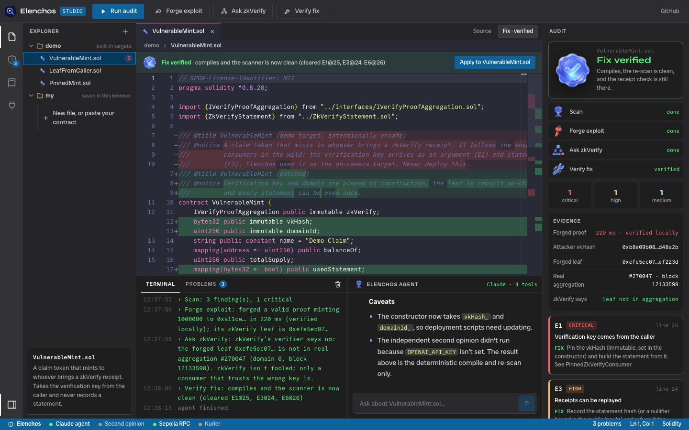

# Elenchos

**A red team for smart contracts that trust zkVerify proofs.** Elenchos cross-examines a contract that consumes
zkVerify aggregation receipts: it scans for the ways a consumer can be fooled, forges a real proof to show the
impact, reads the real zkVerify verifier to show the forged leaf is rejected on its own, and then proposes a fix and
**verifies it by compiling and re-scanning** — not by asking a model to trust itself.

> ἔλεγχος — the Socratic cross-examination that exposes a false claim. Here the claim is "this proof means what you
> think it means."

**🌐 [elenchos-studio.vercel.app](https://elenchos-studio.vercel.app)** · **▶ [Watch the 1:40 demo](https://github.com/nickthelegend/elenchos/releases/download/v0.1.0/elenchos-film.mp4)** (recorded live:
real Claude, Slither, snarkjs, a zkVerify node and the Sepolia verifier) · **[Read the write-up: "zkVerify verified both proofs"](docs/zkverify-verified-both.md)** · **[How we played all four tracks](docs/agent-games-four-tracks.md)**



## Elenchos Studio: an online auditor for ZK contracts

Open the studio (`#/app`) and you get an IDE built for one job: an editor with your contract, a terminal, the agent
next to it, and an audit panel with the verdict.

- **Run audit:** Slither and the five Elenchos detectors on any pasted contract, in about half a second. No model and
  no key; findings land as squiggles on the exact line, in Problems and in the audit panel.
- **Ask the agent:** "Forge exploit", "Ask zkVerify" and "Verify fix" are one click each, or ask in plain words. Every
  tool call streams into the terminal and the chat.
- **Apply the fix:** a verified patch opens as a side-by-side diff; one click applies it to your file.
- **Your files:** new files live in your browser; each audit runs in a throwaway copy of the Foundry project on the
  server, so `../interfaces/...` imports resolve and nothing you paste touches the repo.

The layout follows [AlgoCraft IDE](https://github.com/nickthelegend/algorand-ide); the landing page and 3D art are new
(art generated with ChatGPT, kit in [docs/ART-3D.md](docs/ART-3D.md)).

## Why this exists

zkVerify lets a contract act on a cheap on-chain receipt instead of verifying a SNARK itself. The receipt only says
*some* statement was aggregated. A consumer that builds the statement wrong — taking the verification key from the
caller, never recording what it consumed, moving value before it checks — will accept a proof of a circuit the
attacker wrote. These bugs look fine in a normal test, because a normal test never brings an attacker's own valid
receipt. Elenchos brings one.

<a id="rules"></a>

## The five holes it looks for

| Rule | The hole | The fix |
|---|---|---|
| **E1** | the verification key comes from the caller | pin it as an immutable set in the constructor |
| **E1b** | the caller passes the aggregation leaf itself | rebuild the leaf on-chain from the pinned vk and the inputs |
| **E3** | a receipt is checked but never recorded | record the statement hash; reject the second use |
| **E4** | value moves without checking any receipt | gate the action on a receipt consumed in the same call |
| **E6** | the zkVerify domain id comes from the caller | pin the domain as an immutable |

`PinnedZkVerifyConsumer` (in `contracts/src`) is the safe base that closes all of them; `VulnerableMint` is the
on-camera target that has them.

## The agent

Elenchos is chat-driven. You ask it about a contract and watch it work: Claude drives the investigation with four
real tools, and every call shows up as a card.

- **scan** — the Slither-based detector (`detectors/elenchos_scan.py`), real data-dependency analysis.
- **forge** — a real Groth16 proof from an attacker circuit that mints an arbitrary amount (snarkjs, verified locally).
- **replay** — reads the **real** zkVerify verifier on Ethereum Sepolia and shows the forged leaf returns `false`.
- **patch** — applies a proposed fix to a throwaway copy, compiles it with Foundry, and re-scans. A patch counts as
  verified only when it compiles, the scanner is clean, and it hasn't cheated (deleting or renaming the vulnerable
  function, or ripping out the receipt check). An OpenAI model adds an independent second opinion; the deterministic
  verdict stands on its own.

Nothing is mocked. A tool that can't run (no Kurier key for a full aggregated receipt, no OpenAI key for the review)
says **Setup required** — it never fakes a result.

## What the scanner proves — and what the attack test proves

The scanner is a fast **static pre-filter**: Slither data-dependency analysis that catches the common receipt-consumer
mistakes. Static analysis has limits — it can miss a statement built from a value written in a *previous* transaction,
and "a mapping is written" is a weaker signal than "a unique nullifier is enforced." So Elenchos does not rest the
claim "this fix is real" on the scanner alone. `contracts/test/AttackHolds.t.sol` **proves it dynamically**: a faithful
mock that vouches only for statements an attacker could really get aggregated (their own circuit's) shows the forgery
*mints* on the vulnerable contract and *reverts* on the pinned one, with no value moved — and the honest claim still
works once, then rejects a replay. That runs in CI with no testnet key. The real-verifier replay (reading zkVerify on
Sepolia) and the full forged-receipt fork test (with a Kurier key) are the on-chain versions of the same proof.

## Monorepo

| Package | What it is |
|---|---|
| `contracts/` | Foundry project: `PinnedZkVerifyConsumer`, the `VulnerableMint` / `PinnedMint` demo, statement-hash parity and forged-receipt fork tests |
| `detectors/` | the Python scanner (`elenchos_scan.py`) and its SARIF output (`sarif.py`) for GitHub code scanning |
| `packages/forge` | real Groth16 proofs, zkVerify statement hashing, and the Kurier client + end-to-end attack script |
| `packages/core` | the engine: scan-as-data and the deterministic patch verifier |
| `packages/agent` | the chat agent (Claude + tools), the OpenAI reviewer, and the SSE server |
| `packages/web` | the case-room UI |
| `packages/arena` | a bonus: the Steal the VFY agent for the same Agent Games event (see its own README) |

## Run it

```bash
pnpm install
pnpm -r test                     # all tests; the 3 forged-receipt fork tests skip until a Kurier key is set
(cd packages/web && pnpm build)  # build the UI
ANTHROPIC_API_KEY=... node --experimental-strip-types packages/agent/src/server.ts
# open http://localhost:8787 (landing) and http://localhost:8787/#/app (studio)
```

Or with Docker (bundles Foundry, Slither, Node):

```bash
docker build -t elenchos . && docker run -p 8787:8787 -e ANTHROPIC_API_KEY=... elenchos
# public deployment: also set ELENCHOS_INVESTIGATIONS_PER_HOUR=5 to cap agent runs per visitor
```

Optional keys unlock more: `OPENAI_API_KEY` (second opinion), `SEPOLIA_RPC_URL` (your own fork node; a public one is
the default), `KURIER_API_KEY` (a full real aggregated receipt for the fork tests).

## The scanner as CI

`.github/workflows/elenchos.yml` runs the scan on every `.sol` change and uploads SARIF, so findings appear inline in
a pull request. See [TESTING.md](TESTING.md) for the full test table and [docs/](docs/) for the architecture.

MIT © 2026 Nivesh Gajengi
