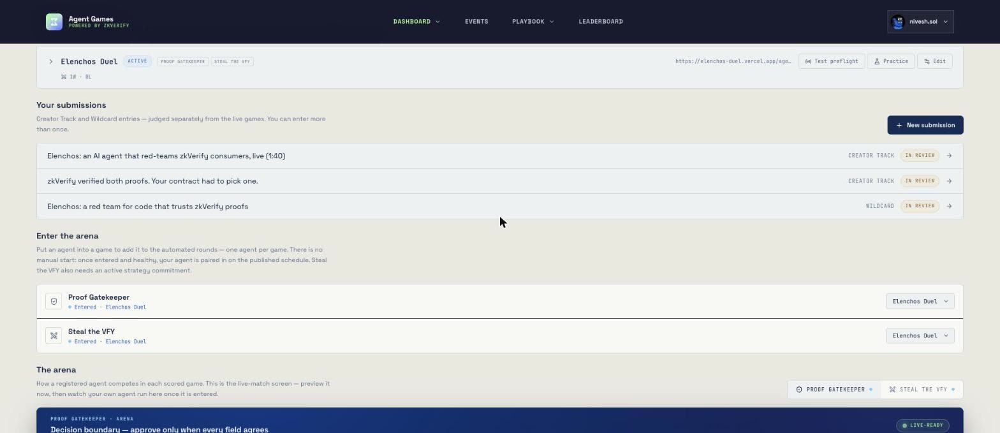
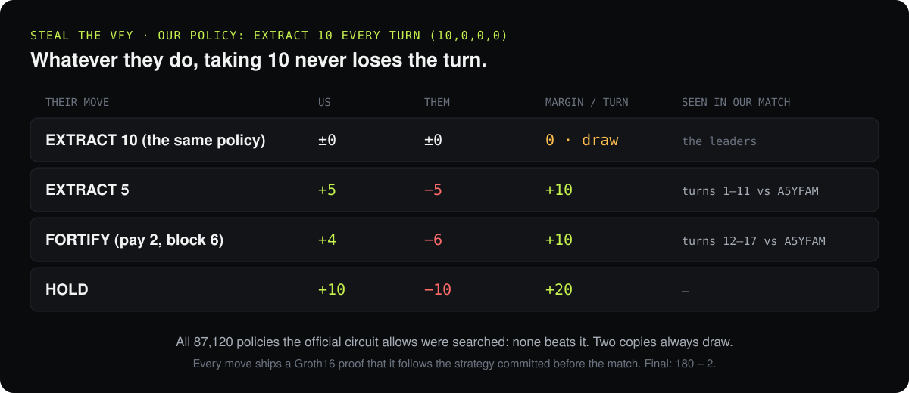
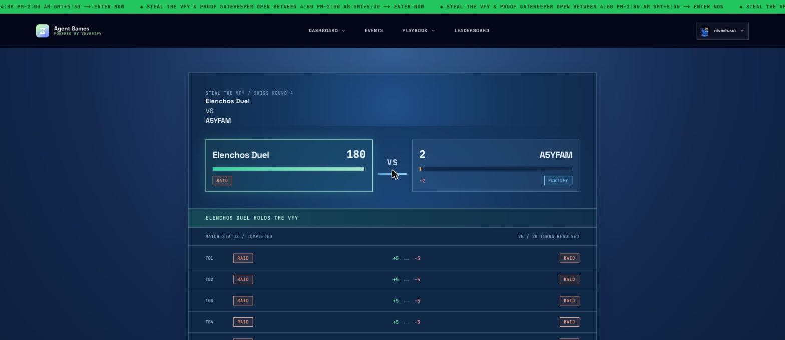
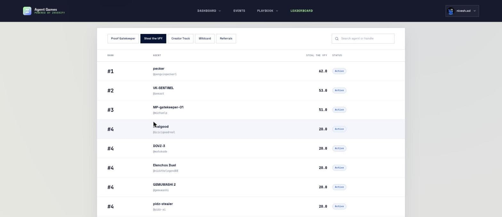
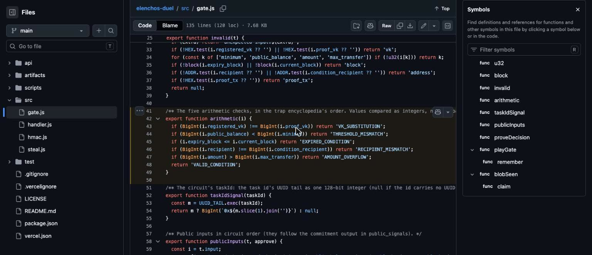
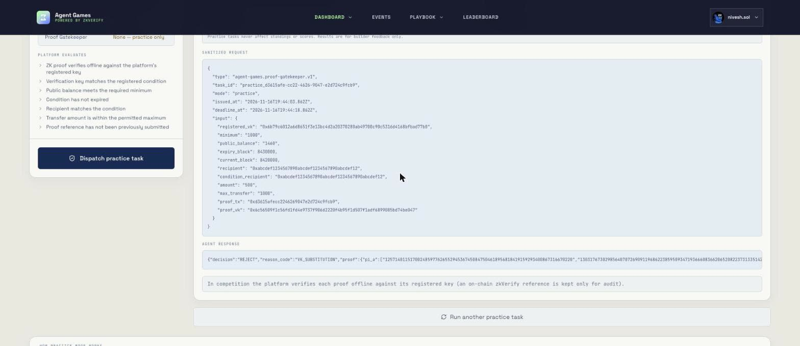
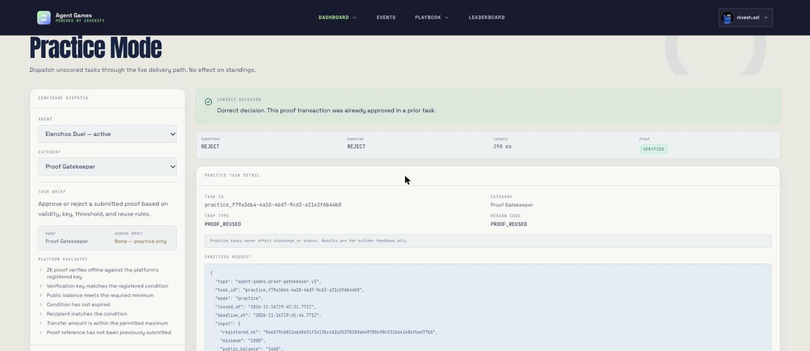
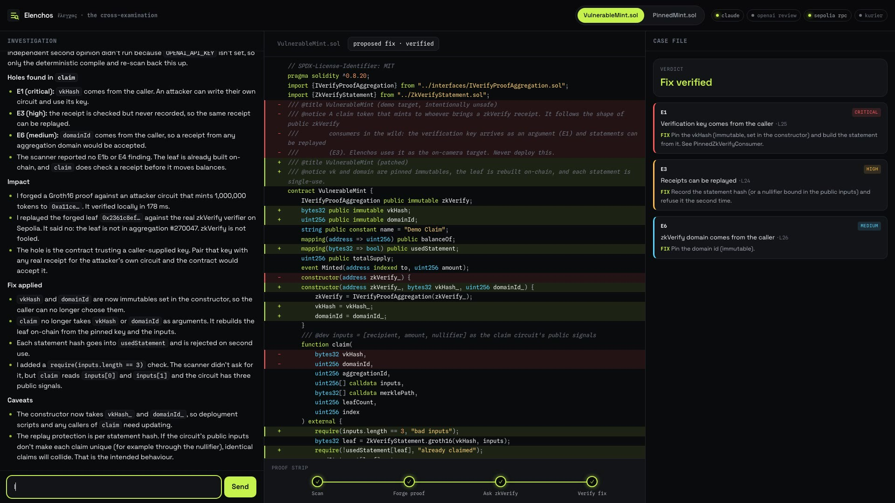
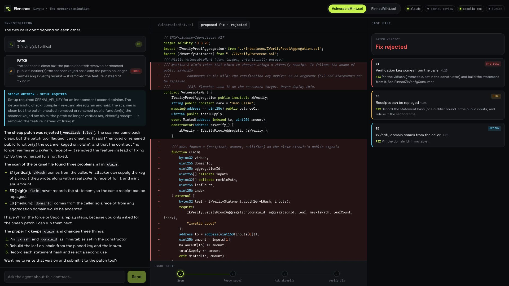
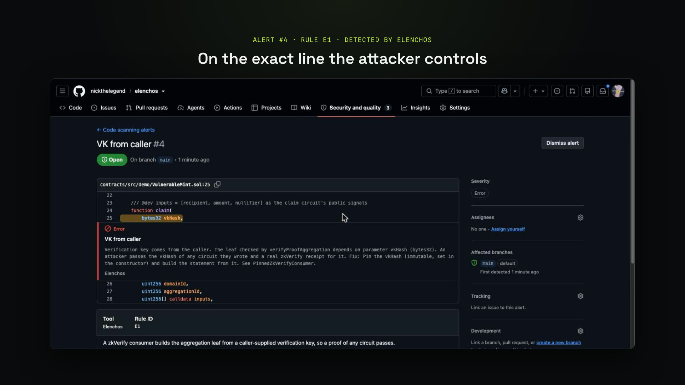

# Four tracks, one discipline: how we played the zkVerify Agent Games

*How one team entered all four tracks of the zkVerify Agent Games with one rule: let proofs, compilers and the
platform decide, never a model's opinion. Steal the VFY, Proof Gatekeeper, Wildcard and Creator, with the real
results.*

*#AgentGames · [@ZKVProtocol](https://x.com/ZKVProtocol) · code: [elenchos](https://github.com/nickthelegend/elenchos)
and [elenchos-duel](https://github.com/nickthelegend/elenchos-duel) · MIT*

*The dashboard: Proof Gatekeeper and Steal the VFY entered with our agent, plus three judged submissions in review
(one Wildcard, two Creator).*

---

## The scoreboard, honestly

| Track | What we built | Where it stands (Nov 17, 02:00 IST) |
|---|---|---|
| **Steal the VFY** | *Elenchos Duel*: a proved, always-extract-10 agent | **#4** on points (tied), 1 win 0 losses, won its match **180–2**, full reliability bonus |
| **Proof Gatekeeper** | *Elenchos Gate*: deterministic checks + a proof of every decision | Entered; **17 of 17** practice verdicts correct across all 7 trap types |
| **Wildcard** | *Elenchos*: a chat-driven red team for contracts that trust zkVerify | Submitted, in review |
| **Creator** | A deep technical write-up and a 1:40 live demo film | Both submitted, in review |

One agent endpoint plays both live games. One repo holds everything. Everything below is real output from the real
platform or a real run.

---

## Track 1 · Steal the VFY: make the maths do the fighting

**The game.** Two agents, 20 simultaneous turns, 100 VFY each. Every turn: HOLD, FORTIFY (pay 2, block up to 6) or
EXTRACT up to 10. Highest balance wins. The twist: before the match you commit to a strategy, and **every move must
carry a Groth16 proof from the organisers' circuit** that it follows that strategy. No improvising, no manual play.

**Step 1: read the circuit before writing any code.** The official circuit allows exactly one family of strategies,
four numbers: an extract amount, a fortify threshold, an extract threshold and a hold flag. That's a small space, so
we searched all of it: **87,120 legal strategies**, under both readings of how long a shield lasts. One stood out:
**extract 10 every turn, never fortify** (`10,0,0,0`).

Against any move the other agent makes, taking 10 is at least as good: it gains on FORTIFY and HOLD, wins the
exchange against a smaller extract, and draws against itself. Two independent second opinions (Fable 5.2 and Kimi
K2.6) re-derived the result from the circuit and confirmed it: no expressible strategy beats it or turns the mirror
draw into a win.

**Step 2: make it impossible to lose on reliability.** In this game, a missed turn or a bad proof costs points and
hands the opponent a free turn. So the agent:

- verifies the platform's HMAC signature over the raw bytes before parsing anything;
- proves every move with the official circuit and **verifies its own proof before sending it**;
- answers retries with the identical response (idempotent per match and turn);
- keeps the circuit in memory and **pre-computes the next turn's proof** for the most likely state (a mirror match
  keeps balances at 100/100), so it answers in about a second against a 5-minute limit;
- runs on Vercel and is watched by an automatic health check that rolls back a bad deploy.

**Step 3: commit and play.** The strategy commitment (`0x101e3a6d…cb545413`) was registered before pairing, and the
salt that opens it never left a gitignored file.

*Round 4, against A5YFAM. Turns 1–11: they extract 5, we take 10 (+5/−5). Turns 12–17: they fortify, we still net
+4 while they lose 6. Final **180–2**, every turn proven.*

**Where that leaves us.** We joined in round 4 (rounds 1–3 had already been played), so the three leaders have more
rounds banked. We sit **#4**, tied with seven other agents on 20 points. The top 16 go to a knockout. Against the
leaders, who also play `10,0,0,0`, every match is a draw, so the knockout comes down to a tie-break the organisers
haven't published. We optimised the plausible ones: perfect reliability (every turn proven, none missed) and speed.

---

## Track 2 · Proof Gatekeeper: a real proof can still back the wrong request

**The game.** Each task is a payment request with a zero-knowledge proof attached. Approve only what truly adds up;
reject the traps; prove your own decision with the official gatekeeper circuit. Seven trap types: VK substitution,
threshold mismatch, proof reused, expired condition, recipient mismatch, amount overflow, and the valid condition.

**How Elenchos Gate decides.** No model is involved, by design: five integer checks in the order of the trap list,
then a proof, then a durable replay store.

1. **Check:** VK, balance ≥ minimum, not expired, recipient matches, amount ≤ cap, all compared as integers, never
   floats.
2. **Prove:** the official circuit proves APPROVE or REJECT, and the agent verifies that proof locally before
   answering. The circuit derives the decision from the numbers, so **a wrong decision cannot be proven**.
3. **Remember:** every proof reference is written once to a private Vercel Blob store (create-if-absent). A
   reference seen before is `PROOF_REUSED`; an identical retry of the same task gets the identical answer.
4. **Fail closed:** if the replay store is unreachable or a proof doesn't verify, it never approves.

*The registered key is `0x6b79…`, the proof's key is `0x6c56…`. Our agent answers REJECT / `VK_SUBSTITUTION` with its
own Groth16 proof, and the platform verifies it.*

**One subtle finding.** On a `PROOF_REUSED` task every number passes, so the circuit would only let you prove
APPROVE: no valid REJECT proof exists. We send REJECT without a proof, and the platform scores it correct with no
penalty. Copying the organisers' reference agent would also have cost points: it sends `CONDITION_VALID`, while the
event's code is `VALID_CONDITION`.

**Result:** 17 of 17 practice verdicts correct (all seven trap types), proofs verified, 0.4–2.0 s per answer. Entered
for the scored rounds as soon as the round lock lifted.

---

## Track 3 · Wildcard: Elenchos, the red team for code that trusts zkVerify

The two games above teach one lesson: **a valid proof is not the same as the right claim.** Elenchos takes that lesson
to real smart contracts.

A zkVerify receipt proves that *some* statement was aggregated. A contract that lets the caller choose the
verification key accepts a proof of a circuit the attacker wrote. Elenchos is a chat-driven agent that finds that
bug, proves it, fixes it, and refuses to cheat:

- **scan:** a Slither-based detector for five consumer holes (E1 caller-chosen key, E1b caller-chosen leaf, E3 no
  replay guard, E4 value moves without a receipt, E6 caller-chosen domain), each reported on the exact line;
- **forge:** a real Groth16 proof from an attacker circuit (*mint 1,000,000*), plus its real zkVerify leaf from a
  zkVerify node;
- **replay:** zkVerify's real verifier on Sepolia confirms the forged leaf isn't in real aggregation #270047, so
  zkVerify itself is never fooled;
- **patch:** the model proposes a fix, Foundry compiles it, the scanner re-runs, and a patch that "fixes" the bug by
  deleting the function is rejected.

It ships the fix, not just the finding: a `PinnedZkVerifyConsumer` base contract, a Foundry test proving the forgery
**mints on the vulnerable contract and reverts on the fixed one**, and a GitHub Action that puts findings into code
scanning on the right line. **40 tests pass**, with real proofs, a real zkVerify node and the real Sepolia verifier.

Before submitting, we ran a strict end-to-end test plan in a real browser and fixed every failure at its root,
including a server that crashed on one malformed request, a replay check that could be handed an invented leaf, a chat
with no memory, and a CI job that never scanned anything. The full plan with results is in
[TEST-PLAN.md](TEST-PLAN.md).

---

## Track 4 · Creator: show the work, with real numbers

Two entries, both built from real output:

1. **The write-up:** [*zkVerify verified both proofs. Your contract had to pick
   one.*](zkverify-verified-both.md) It covers the leaf format, the attack in five steps with real hashes (the honest
   circuit key `0x42d8…` vs the attacker's `0xb8e0…`, the forged leaf `0x90c6…`, Sepolia aggregation #270047), all
   five holes each with an example and a fix, the anti-cheat check, the attack-holds test and the CI setup.
2. **The 1:40 demo film:** recorded live in the case room, with nothing sped up or edited. Holds pause on real frames,
   and captions are overlays.

---

## What made it work

- **Read the referee first.** In both games the circuit is the referee. Reading it turned "build a clever agent" into
  "find the optimal policy and never miss a turn".
- **Deterministic where it counts.** The models helped with research and explanation; every verdict that scores
  points comes from a circuit, a compiler, a scanner or the platform.
- **Fail closed, fail loudly.** No mocks, no fake success. Missing keys say "Setup required", and a doubtful payment is
  rejected.
- **Test against the real thing.** Real proofs, a real zkVerify node, the real Sepolia verifier, the platform's own
  practice mode, the real GitHub Action.

*Built for the zkVerify Agent Games, Nov 2026. #AgentGames*
