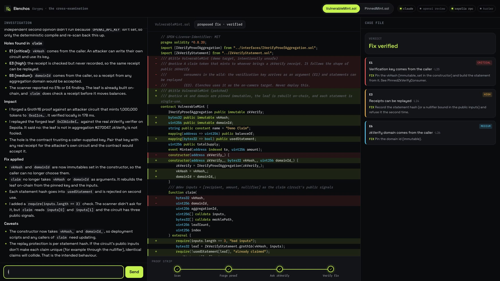
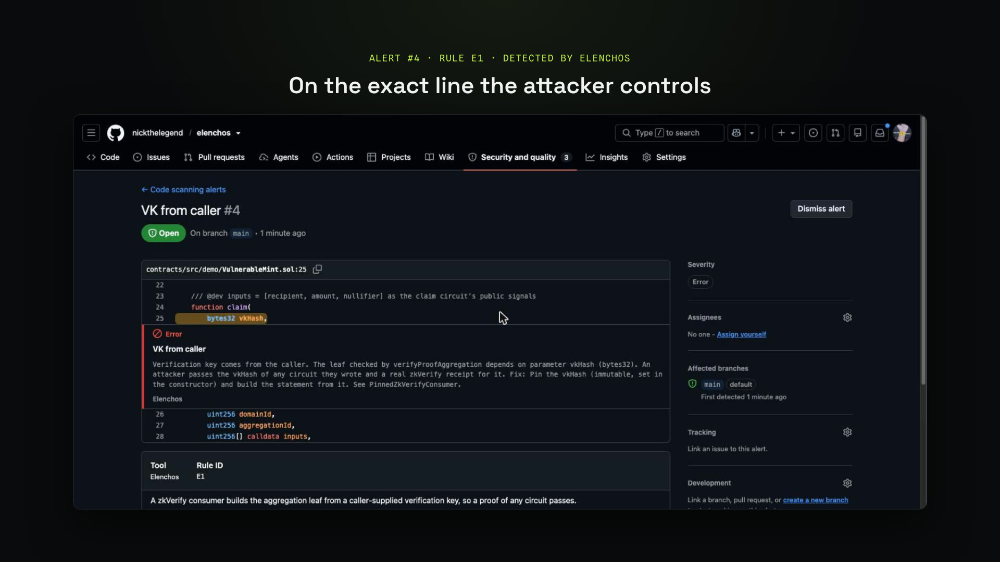

# zkVerify verified both proofs. Your contract had to pick one.

*How a correct proof can still drain a token, and an agent that finds, proves and fixes that bug class.*
*#AgentGames · built for the zkVerify Agent Games · [@ZKVProtocol](https://x.com/ZKVProtocol)*



## The one-line version

zkVerify answers a precise question: *was this statement aggregated?* Your contract has to answer a different one: *is this
the statement I meant to accept?* When the contract lets the caller choose any part of that statement, an attacker brings a
proof of a circuit they wrote, zkVerify honestly says "yes, verified", and the contract pays out.

Nothing in zkVerify is broken when this happens. The bug lives in the consumer, which makes it easy to miss: every test
that uses honest proofs passes.

## What a zkVerify receipt actually proves

When zkVerify aggregates a Groth16 proof and posts the result to Ethereum, each proof becomes a leaf in a Merkle tree:

```
leaf = keccak256( provingSystemId ‖ vkHash ‖ versionHash ‖ keccak256(public inputs) )
```

A consumer contract rebuilds that leaf and asks the verifier contract whether it belongs to an aggregation:

```solidity
bytes32 leaf = ZkVerifyStatement.groth16(vkHash, inputs);
require(zkVerify.verifyProofAggregation(domainId, aggregationId, leaf, merklePath, leafCount, index));
```

Everything that goes into `leaf` decides what the contract trusts. If `vkHash` arrives as a function argument, the caller
picks the circuit. A circuit is just a program the prover chooses. The attacker writes one that "proves" whatever
they like, for example "mint 1,000,000 tokens to me", registers its key with zkVerify, and submits a real proof.
zkVerify aggregates it, because it is a valid proof, and the consumer accepts it, because it never pinned which circuit it
expected.

The same shape gives four more holes:

| Rule | The consumer… | Fix |
|---|---|---|
| **E1** | takes the verification key from the caller | pin `vkHash` as an immutable set at deploy |
| **E1b** | takes the leaf itself from the caller | rebuild the leaf on-chain from the pinned key and the inputs it acts on |
| **E3** | checks a receipt but never records it | store the statement hash (or a nullifier in the public inputs) and refuse it twice |
| **E4** | moves balances without checking any receipt | gate every value move on a receipt checked in the same call |
| **E6** | takes the aggregation domain from the caller | pin the domain id |

## The demo target

`VulnerableMint.sol` is a short claim token, written deliberately to follow the common consumer pattern:

```solidity
function claim(
    bytes32 vkHash,        // ← E1: the caller picks the circuit
    uint256 domainId,      // ← E6: and the domain
    uint256 aggregationId,
    uint256[] calldata inputs,
    bytes32[] calldata merklePath,
    uint256 leafCount,
    uint256 index
) external {
    bytes32 leaf = ZkVerifyStatement.groth16(vkHash, inputs);
    require(
        zkVerify.verifyProofAggregation(domainId, aggregationId, leaf, merklePath, leafCount, index),
        "invalid proof"
    );
    // E3: nothing records `leaf`, so the same receipt works again
    address to = address(uint160(inputs[0]));
    uint256 amount = inputs[1];
    balanceOf[to] += amount;
    totalSupply += amount;
    emit Minted(to, amount);
}
```

It compiles, it has tests, and an honest user can claim with it. It is also free money for anyone with a laptop.

## Elenchos: cross-examine the contract, don't just warn

*Elenchos* (ἔλεγχος) is the Greek word for Socrates' method: test a claim until it breaks. The agent is a chat. You ask
about a contract and watch it work. Claude drives four real tools, each shown as a card with its raw output:

1. **scan:** a deterministic detector built on Slither's data-dependency analysis. It reports which parameter the leaf
   depends on, so a finding names the exact line the attacker controls (`vkHash`, line 25).
2. **forge:** a real Groth16 proof from an attacker circuit that mints 1,000,000 tokens, verified locally with snarkjs.
   It then asks a **real zkVerify node** (`vk_hash_groth16`) for the attacker key's hash and computes the exact leaf
   zkVerify would aggregate. That hash function is checked against the two keys the Agent Games organisers registered on
   zkVerify mainnet; both match byte for byte.
3. **replay:** asks zkVerify's **real verifier on Ethereum Sepolia** whether that forged leaf is in its latest real
   aggregation (read from the verifier's own events). The answer is no. zkVerify isn't fooled; the consumer is the
   weak point. The tool takes no input: it can only replay the leaf forge actually produced, so the model can't invent one.
4. **patch:** the agent proposes a full fixed file. Elenchos writes it to a throwaway copy, compiles it with Foundry and
   re-runs the scanner. **The model proposes; the compiler and the scanner decide.**


### "Can't the model just cheat?"

The obvious way to make a scanner happy is to delete the code it complains about. The patch checker refuses that: a patch
that removes or renames a public function, or rips out `verifyProofAggregation`, is reported as *cheated* even if the
scanner comes back clean. In the case room you can ask the agent to try it. It does, the tool says
*"the patch cheated … it removed the feature instead of fixing it"*, and the verdict turns to **Fix rejected**.

### Proof that the fix holds

Static checks are a filter, not a proof. So the repository ships `AttackHolds.t.sol`: a Foundry test with an aggregator
that vouches only for leaves an attacker could really get aggregated. The forged claim **mints** on `VulnerableMint` and
**reverts with no value moved** on `PinnedMint`; the honest claim works once and the replay is rejected. No API keys
are needed to run it:

```
[PASS] test_forgery_mints_on_vulnerable()
[PASS] test_forgery_reverts_on_pinned()
[PASS] test_honest_claim_works_once_on_pinned()
```

## It runs where the bugs are written: in CI

The same detector emits SARIF, and a GitHub Action uploads it, so findings show up in GitHub code scanning on the exact
line of a pull request:



## Use the fix, not just the finding

`PinnedZkVerifyConsumer.sol` is a base contract that does it right: the key and domain are immutable, the leaf is rebuilt
from the inputs the contract acts on, and each statement is consumed once. Inherit it and call `_consume(...)` before you
move value.

## Honest limits

- The scanner knows five rules. A contract can be wrong in ways it doesn't model; that's why the fix is also proven with
  a Foundry test and why every claim in the chat is backed by a tool result.
- The end-to-end exploit with **real** aggregated receipts on a Sepolia fork (`ForgedReceipt.fork.t.sol`) needs a Kurier
  testnet key; until one is set, those 3 tests are skipped and say so. They are never faked.
- The second-opinion review by another model needs its own key and is shown as "Setup required" without it.

## Try it

```bash
git clone --recursive https://github.com/nickthelegend/elenchos && cd elenchos
pnpm install && pnpm -r test                   # 35 package tests, real proofs and real network reads
cd contracts && forge test                      # parity + the attack-holds proof
```

The case room needs an Anthropic key (`ANTHROPIC_API_KEY`), then
`node --experimental-strip-types packages/agent/src/server.ts` and open `http://localhost:8787`.

---

*Elenchos is open source (MIT). Built for the zkVerify Agent Games, Nov 2026. #AgentGames*
